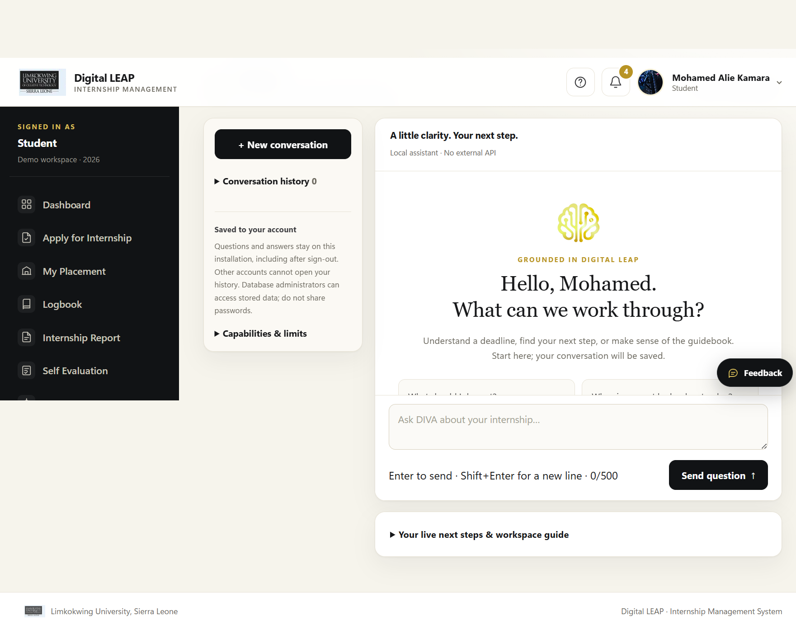

# Digital LEAP Internship Management System — User Guide

**For:** students, host supervisors, academic mentors, LEAP coordinators, management/AQA staff and system administrators of the Digital LEAP internship programme.
**What this guide covers:** how to sign in and how to carry out each role's weekly work. Setup and demonstration accounts are in `INSTALL.txt`; the marker's walkthrough is in `VERIFY.md`.

---

## 1. Purpose, roles and signing in

Digital LEAP replaces the paper internship file with one record set: ranked placement
preferences, allocation, weekly logbooks, supervisor and mentor evaluation, the
internship report, the Career Fair report and the final mark out of 200. Every role
sees only its own part of that record; no permission grants access to another
person's file.

The six roles and what each is for:

| Role | What the role does in the system |
| --- | --- |
| Student | Applies for a placement with a CV, writes and submits weekly logbook entries, uploads the internship and Career Fair reports, completes a self evaluation, reads the published result. |
| Host supervisor | Reviews and approves or returns the weekly logbook entries of students placed at their organisation, comments on entries, and scores Form D. |
| Academic mentor | Reviews logbooks after the supervisor, records site visits, assesses the internship report, and sees the Career Fair submissions. |
| LEAP coordinator | Manages organisations and applications, allocates placements, runs site visits, computes, moderates and publishes marks. |
| Management / AQA | Reads programme KPIs, prints the management report and exports data. |
| System administrator | Creates and suspends accounts, resets passwords, maintains the permission matrix and settings, reads the audit trail and the feedback inbox, and processes queued mail. |

**Signing in.** Open the application address supplied with your installation and choose
**Sign in**, or go straight to `?r=login`. Enter your institutional email address and
password; passwords are case-sensitive, and the eye button beside the field reveals what
you have typed. A demonstration copy offers one-click buttons for each demo role.

A new account arrives with an initial password that must be changed at first sign-in: the
system redirects to **Profile** until the new one is saved. A password needs at least eight
characters, an uppercase letter, a lowercase letter and a number. Five wrong passwords in
a row lock the account for fifteen minutes; an administrator can unlock it.

**Finding your way around.** The left menu lists the pages your role may open; on a phone
it collapses into a drawer. The bell shows notifications and an inbox preview, and the
envelope opens placement messages. A short guided tour runs after registration and can be
repeated from **Take the tour**. Your name, role and photo sit at the top of the menu, and
**My settings** is in the account menu and at the foot of the sidebar.

---

## 2. Student and host supervisor: the weekly logbook cycle

*The assistant welcome screen. DIVA is available to every role and answers from that
account's own records and from the internship guidebook.*

**Applying (student).** **Apply for internship** collects your ranked choices, each with
sector, district and motivation. Use **Move up** and **Move down** to reorder; the ranks
renumber immediately. Attach a CV as PDF, Word, JPG or PNG. Once the coordinator has
allocated a placement the preference list becomes read-only.

**Your placement and progress (student).** **My placement** shows the organisation, the
academic year and semester, your supervisor and mentor; the paper forms A2 (industrial
training agreement), A3 (placement agreement) and B (industrial training notification) are
signed against this record. **Placement letter** opens a
printable confirmation letter. The dashboard's **Internship progress** card tracks
placement, logbook, both evaluations, the site visit, the report and publication.

**Attendance (student).** The **Attendance** card on **My placement** has **Check in at
site** and **Check out** — press one when you arrive or leave, once a day each. Your
location is read only at that moment and is stored with the record; if you decline it,
the check-in is saved as attested and you can carry on. Each record shows the time and,
once the coordinator has set the site pin, how far you were from it. Students are tracked
only at their own placement; staff record their own site visits separately, under
**Visits**.

**Writing a logbook entry (student, Form E — 50%).** Open **Logbook (Form E)** and choose
the week. The entry
follows the paper log book: a row per day with the day, date, tasks performed and hours,
so leave a row empty for weekends or holidays. The week total comes from those rows. Below
the daily table write the weekly summary and, when they apply, the technical skills,
challenges, mentor or industry-supervisor meeting and reflection sections. **Save draft**
while still working or **Submit** when ready; an entry needs at least one day before it
can be submitted. A submitted entry cannot be edited; a supervisor may return it with a
comment, and a returned entry can be corrected and resubmitted. Attach evidence files and
download them later. Use **Reply** under a comment to answer in a threaded conversation.
Each day you save is emailed to your host supervisor and academic mentor that evening, even
while the week is a draft; submitting emails the full week to both. Each day row also has
**Send** so you can push a finished day to both of them straight away — Monday's record can
go on Monday — and the button then reads **Sent**. Sending a day does not submit the week;
the full week still goes to them when you submit. The official 16-page log
book template opens or downloads from the same page.

**Reviewing entries (host supervisor, Form E).** **Logbook queue (Form E)** lists the entries waiting for you, newest
submission first. Narrow the list with the **Status** and **Week** filters at the top of the
list and press **Apply filters**; press **Reset** to clear them. Open an entry from the
queue to read the daily records, the weekly summary and sections, the attachments and the
conversation. **Approve** passes it to the mentor; **Return** sends it back to the student
and requires a comment saying what must change. Comment on an approved entry at any time.
The queue never shows a draft the student has not submitted. Draft days still reach you one
at a time by email, named as drafts, so you can follow progress; formal review starts when
the student submits the week. The entry also shows the student's site check-ins with the
time of each and the distance from the site pin once the coordinator has set one.

**Form D (host supervisor, D1 at week 6 and D2 at week 12).** **Form D evaluation** scores the six workplace criteria with
their printed weights. The form cannot be saved half-finished, and the weights must total
the stated maximum. Once saved, the total becomes the Form D component — 40 of the 100
practical marks. The equivalent **Mentor evaluation** screen uses the mentor's own
criteria, is advisory and carries no marks.

---

## 3. Mentor, coordinator, management and administrator: assessment and oversight

**The rest of the assessment chain.** The academic mentor opens **Logbook review (Form E)** to review
entries the supervisor has approved; a comment moves the entry to mentor-reviewed.
**Visits** records each site visit with its date, mode and outcome, and filters by student,
status and date range. A physical visit needs a GPS **check-in at the site** before it
can be completed: press the button on the visit row when you arrive, the browser reads
your location once, and the visit shows **Site verified** with the time and distance. A
reading more than 500 m from the site pin is refused; virtual and phone visits need none.
Coordinators record their own monitoring check-ins under **Staff site visits** on the
placement page, and the coordinator's **Visits** screen lists those alongside the mentors'.
**Report assessment (Form C)** assesses the internship report (75 of the 200 marks) and
lists the Career Fair submissions with their timing; opening a file marks it reviewed. The
mentor's own evaluation (40/35/25) is recorded for information and carries no marks.

**Allocation (coordinator).** **Applications** lists active students with their ranked
preferences and whether a CV is attached; filter by name or CV status. **Placements**
filters by academic year, status and organisation. **Allocate** refuses a student who
already holds a placement for that year, a supervisor from another organisation, and an
allocation beyond the organisation's capacity.

**Marks (coordinator).** **Grades (Form E)** shows each placement's components and running total.
The final mark is out of 200: Practical Internship 100 (logbook 50, Form D 40, self
evaluation 10) plus Internship Report 75 plus Career Fair 25. Enter the Career Fair score,
then **Compute**, **Moderate** if justified, and **Publish**. A published mark cannot be
recomputed. The grade sheet prints from the same page.

**Oversight (management/AQA and administrator).** Management sees placement, completion,
grade distribution and logbook compliance, each bar labelled with its count and share,
and can print the report or export CSV. The administrator maintains users (create,
suspend, unlock, reset password), the 39-permission matrix, the assessment weights and
session settings, the audit trail and the feedback inbox. Audit filters by action, entity,
user and date range; feedback filters by rating and source page. Every filter is a plain
GET form, so a filtered view can be bookmarked and never changes a record.

**Profile photo.** **Profile** accepts a JPG, PNG or WebP image up to 8 MB, previews it in
the header before saving, and can remove it again. Where no photo exists the person's
initials are shown. A photo is served only to someone who could already see that person in
the product — yourself, staff with directory access, or a participant in the same
placement, conversation or logbook thread.

**My settings.** Every role has the same page, and it only ever changes your own account.
Four boxes choose which notifications are also copied to email — logbook, placement,
messages, marks. Clearing one removes the email copy, never the item in the bell or your
history. **Text size** and **Reduce motion** take effect the moment you pick them and follow
your account to any device you sign in from. The **This device** card shows what this browser
holds for offline work — installed state, saved DIVA answers, log book changes waiting to
send, cached pages — and can clear the device-side copies, which touches no record in the
database.

**Messages.** Students, mentors and coordinators have placement conversations with quoted
replies, reactions, unread counts and a fifteen-minute edit window. A student can message
their own mentor and coordinator; students cannot message one another, and a deleted
message leaves a tombstone so replies keep their place.

**Guidebook.** Every role has **Guidebook** at the foot of the menu. **Open the PDF** shows
the full 25-page internship guidebook in your browser; **Download PDF** saves the same file
for printing or keeping. The list below names every page; choosing one opens the same PDF
at that page in your browser's viewer, so you always read the document itself. DIVA's
citations still offer the page as plain text, and that text page links back to the PDF.

**DIVA.** Every role has the assistant in the left menu. It answers in three ways and names
which one it used: fixed rules over your own live records, a quoted passage from the
internship guidebook with its page number, or an honest statement that it cannot help. It
can describe your records, explain its own limits, and comment on a report draft against
the eight Form E criteria without giving a mark. It cannot approve work, publish a grade or
send a message, and it says so when asked. Conversations are saved to your own account and
can be reopened or archived; archiving hides a conversation without deleting it. Answers
are snapshots, so ask again for current figures.

**Install it and work offline.** In Chrome or Edge, add Digital LEAP to your home screen from the browser's address-bar install control, or from **How to install this app** in the account menu or on **My settings** — saying **Not now** hides the banner only, and those controls are still there tomorrow. Desktop Firefox has no install button for this kind of app; the settings page says so and points to Chrome or Edge, and everything else works the same there. Once installed, pages you have opened stay readable without a connection, log book edits are saved on the device and sent when you reconnect, and DIVA keeps answering guidebook questions from a copy stored on the device. Answers that need live records are refused honestly while offline and your question is queued; reconnect and the queued questions are sent with one notice. Signing out removes saved DIVA answers and cached pages from the device.

---

*Screenshots accompanying this guide are held in `docs/screenshots/`. Only the welcome
screen shown above exists in the current package; add the remaining role screenshots to
that folder before printing the guide.*
